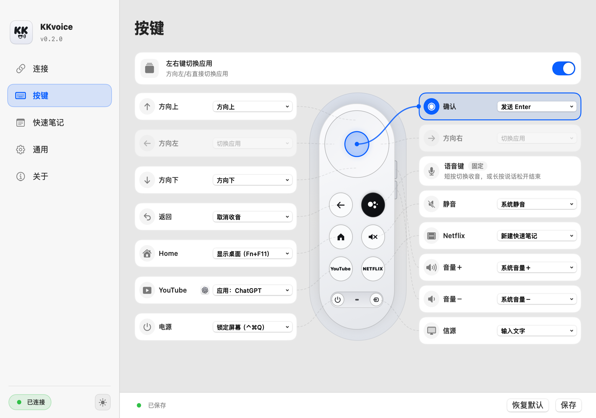

# KKvoice

把 Google TV / Chromecast 语音遥控器变成 Mac 无线麦克风与快捷遥控器。


## 功能亮点

- **语音遥控器当麦克风**：按遥控器语音键（或 Mac 键盘唤醒键）即可收音，将音频实时转发至虚拟麦克风 `KKvoice Mic`，直接用于 Vokie 等语音输入软件。
- **自动切换音源（待机零采集）**：**待机时不采集任何麦克风**；遥控器连接就绪时使用遥控器麦克风，断开或休眠时按唤醒键收音会自动切换为所选的 Mac 物理麦克风（仅在收音期间按需开启，收音结束立即释放）。
- **智能蓝牙搜索与零功耗离线待机**：启动与遥控器按键唤醒时自动搜索秒连；带 MacBook 外出（遥控器不在身边）时自动停止蓝牙扫描进入**零功耗待机**，无缝使用 Mac 麦克风，回家按遥控器任意键通过系统 HID 事件瞬间自动重连。
- **按键映射**：直观的遥控器键位视图，支持将方向键、确认、返回、Home、YouTube、Netflix、静音、音量、电源、信源等按键映射为系统快捷键、打开/切换应用、输入文字或系统控制。
- **闪念笔记联动**：一键触发闪念笔记（SnapNote）新建笔记，并自动添加自定义标签（1–20 字，默认「闪念」）。
- **应用内一键更新**：支持启动/定时自动检查 GitHub 新版本、弹窗提醒、一键下载校验签名并替换重启，可在「通用」页开启或关闭「自动检查更新」与「自动安装更新」。

## 界面截图

### 按键映射


### 闪念笔记


### 通用与权限


## 下载与安装

1. **下载应用**：前往 [GitHub Releases](https://github.com/intelKANG/KKvoice/releases/latest) 下载最新 `KKvoice-*.zip`，解压后将 `KKvoice.app` 拖入 `/Applications`（应用程序）。
2. **首次打开**：应用及内置驱动/辅助进程已使用 **Apple 开发者证书 + Hardened Runtime** 签名，但尚未经过 Apple 公证（Notarization）。首次打开若遇系统拦截，请**在访达中右键点击 `KKvoice.app` 选择「打开」**（或在「系统设置 → 隐私与安全性」中点击「仍要打开」），也可在终端执行：
   ```sh
   xattr -dr com.apple.quarantine /Applications/KKvoice.app
   ```
3. **安装虚拟声卡**：应用已内置基于 BlackHole `v0.6.1`（GPLv3）源码编译的 `KKvoice Mic` 虚拟声卡驱动，**无需事先外部安装 BlackHole 或 vRemoteDriver**。首次启动未检测到驱动时会自动弹窗提示一键安装，也可随时在「连接」或「通用」页面点击**「安装 KKvoice Mic」** / **「重新安装驱动」**并输入管理员密码完成安装。
4. **授予系统权限**：根据功能需要在「系统设置 → 隐私与安全性」中开启：
   - **蓝牙**：连接并接收遥控器语音与按键
   - **辅助功能**：发送模拟快捷键与监听唤醒键
   - **输入监控**：响应遥控器按键与全局唤醒快捷键
   - **麦克风**：在遥控器未连接时使用所选 Mac 物理麦克风作为备用音源（仅收音期间按需开启，待机不采集）

> 系统要求：macOS 13.0（Ventura）及以上（支持 Apple Silicon 与 Intel Mac）。

## 使用步骤

1. **首次蓝牙配对**：首次连接新 Mac 时，同时长按遥控器**「返回 `←` + 主页 `🏠`」3–5 秒**至指示灯闪烁，在 macOS「系统设置 → 蓝牙」中连接 `Chromecast Remote`（连接页亦内置配对提示与「蓝牙设置」快捷入口）。
2. **设置虚拟麦克风**：打开 KKvoice，按提示一键安装虚拟麦克风 `KKvoice Mic`，然后将语音输入软件（如 Vokie）的麦克风输入设为 `KKvoice Mic`。
3. **配置快捷键与备用麦**：在「连接」页设置语音输入软件的触发快捷键与备用 Mac 麦克风（连接或搜索中修改即刻生效）。
4. **开始语音输入或自定义按键**：按下遥控器语音键（或键盘唤醒键）开始说话，或在「按键」页自定义各个遥控器按键功能。

## 从源码构建

需要 macOS 13.0+ 与完整 Xcode（供 `./Scripts/build-app.sh` 自动调用 `Driver/build-blackhole-driver.sh` 从 BlackHole `v0.6.1` 源码编译 `KKvoiceMic.driver`）：

```sh
swift test
./SessionTests/run.sh
./AudioTests/run.sh
./NativeTests/run.sh
./KeyboardTests/run.sh
./SnapNoteTests/run.sh
./Scripts/build-app.sh
open dist/KKvoice.app
```

- `swift test`：运行 `Tests/KKvoiceTests` 下的 33 个单元测试。
- `./*Tests/run.sh`：运行 5 组独立模块回归测试。
- `./Scripts/build-app.sh`：自动构建 `KKvoiceMic.driver`、辅助进程 `KKvoiceRemoteHelper.app` 与主程序 `KKvoice.app`，并检测本机 Apple 证书完成由内向外的 Hardened Runtime 签名（未检测到证书时回退至 `-` 本地签名）。

架构说明与开发指南详见 [DEVELOPMENT.md](DEVELOPMENT.md)。

## 鸣谢与许可

- [BlackHole](https://github.com/ExistentialAudio/BlackHole)（GNU GPL v3）：内置的 `KKvoice Mic` 虚拟声卡驱动基于 BlackHole `v0.6.1` 源码编译。
- [vRemoter](https://github.com/VincentKingHsu/vRemoter)：提供 Chromecast 语音遥控器与 ATVV 协议兼容性参考。

第三方源码来源与许可证说明详见 [THIRD_PARTY_NOTICES.md](THIRD_PARTY_NOTICES.md)。

---

## English

**KKvoice** is a native macOS companion app for Google TV / Chromecast voice remotes. It turns the remote into a wireless microphone (`KKvoice Mic`) for voice dictation apps (such as Vokie), automatically falls back to a selected physical Mac microphone during active sessions when the remote is disconnected (zero mic capture while idle), enters zero-power passive standby when you take your MacBook on the go and reconnects instantly on any remote keypress via macOS HID events, maps remote buttons to macOS shortcuts/apps/text, integrates with SnapNote (with customizable tags, defaulting to `"闪念"`), and includes a built-in GitHub Releases auto-updater.

- **Requirements**: macOS 13.0 (Ventura) or later (Apple Silicon & Intel).
- **First-Time Remote Pairing**: Hold **Back `←` + Home `🏠`** on the remote for 3–5 seconds until the LED pulses, then connect **Chromecast Remote** in System Settings → Bluetooth.
- **Download**: Grab the latest archive from [Releases](https://github.com/intelKANG/KKvoice/releases/latest) and move `KKvoice.app` to `/Applications`.
- **First Launch (Signed with Apple Developer certificate + Hardened Runtime, not notarized)**: Right-click `KKvoice.app` → **Open** (or allow in System Settings → Privacy & Security), or run:
  ```sh
  xattr -dr com.apple.quarantine /Applications/KKvoice.app
  ```
- **Bundled Virtual Audio Driver (`KKvoice Mic`)**: Built from [BlackHole](https://github.com/ExistentialAudio/BlackHole) `v0.6.1` source under GPLv3 and bundled inside the app — no separate BlackHole or vRemoteDriver pre-installation required. On first launch, follow the automatic prompt or click **安装 KKvoice Mic** (`Install KKvoice Mic`) in the Connection / General tab.
- **Permissions**: Grant Bluetooth, Accessibility, Input Monitoring, and Microphone access in System Settings → Privacy & Security.
- **Development & Notices**: See [DEVELOPMENT.md](DEVELOPMENT.md) and [THIRD_PARTY_NOTICES.md](THIRD_PARTY_NOTICES.md).
