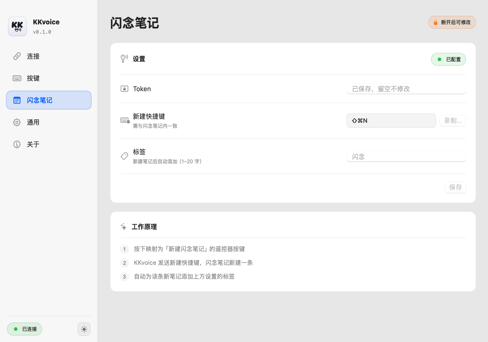
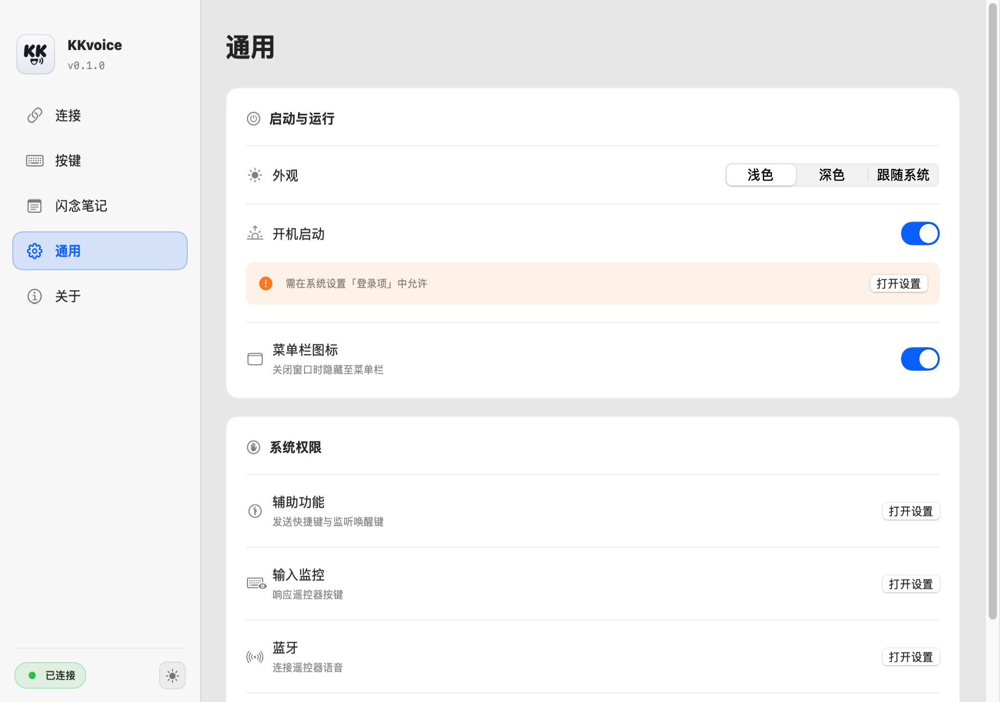

# KKvoice

把 Google TV / Chromecast 语音遥控器变成 Mac 无线麦克风与快捷遥控器。


## 功能亮点

- **语音遥控器当麦克风**：按遥控器语音键（或 Mac 键盘唤醒键）即可收音，将音频实时转发至虚拟麦克风，直接用于 Vokie 等语音输入软件。
- **自动切换音源**：遥控器连接就绪时使用遥控器麦克风，断开或休眠时自动切回指定的 Mac 麦克风，无需在语音软件中频繁切换输入设备。
- **按键映射**：直观的遥控器键位视图，支持将方向键、确认、返回、Home、YouTube、Netflix、静音、音量、电源、信源等按键映射为系统快捷键、打开/切换应用、输入文字或系统控制。
- **闪念笔记联动**：一键触发闪念笔记（SnapNote）新建笔记，并自动添加自定义标签。

## 界面截图

### 按键映射


### 闪念笔记


### 通用与权限


## 下载与安装

1. **下载应用**：前往 [GitHub Releases](https://github.com/intelKANG/KKvoice/releases/latest) 下载最新 `KKvoice-*.zip`，解压后将 `KKvoice.app` 拖入 `/Applications`（应用程序）。
2. **首次打开**：应用使用本地 Ad-hoc 签名（未经过 Apple 公证）。首次打开请**在访达中右键点击 `KKvoice.app` 选择「打开」**，或在终端执行：
   ```sh
   xattr -dr com.apple.quarantine /Applications/KKvoice.app
   ```
3. **安装虚拟声卡**：首次打开应用后，点击界面上的**「安装 KKvoice Mic」**并输入管理员密码即可完成驱动安装（也可选择系统已有的 BlackHole 兼容虚拟音频设备）。
4. **授予系统权限**：根据功能需要在「系统设置 → 隐私与安全性」中开启：
   - **蓝牙**：连接并接收遥控器语音与按键
   - **辅助功能**：发送模拟快捷键与监听唤醒键
   - **输入监控**：响应遥控器按键与全局唤醒快捷键
   - **麦克风**：在遥控器未连接时使用 Mac 麦克风作为备用音源

> 系统要求：macOS 12 及以上（开机自启设置需 macOS 13 及以上）。

## 使用步骤

1. 在 macOS「系统设置 → 蓝牙」中配对 Google TV / Chromecast 语音遥控器。
2. 打开 KKvoice，安装并选择虚拟麦克风 `KKvoice Mic`，然后将语音输入软件（如 Vokie）的麦克风输入设为 `KKvoice Mic`。
3. 在「连接」页设置语音输入软件的触发快捷键与备用 Mac 麦克风。
4. 按下遥控器语音键开始说话，或在「按键」页自定义各个遥控器按键功能。

## 从源码构建

需要安装 Xcode（用于编译虚拟声卡驱动）或 Xcode Command Line Tools：

```sh
swift test
./SessionTests/run.sh
./AudioTests/run.sh
./NativeTests/run.sh
./KeyboardTests/run.sh
./SnapNoteTests/run.sh
./Scripts/build-app.sh
open dist/KKvoice.app
```

架构说明与开发指南详见 [DEVELOPMENT.md](DEVELOPMENT.md)。

## 鸣谢与许可

- [BlackHole](https://github.com/ExistentialAudio/BlackHole)（GNU GPL v3）：内置的 `KKvoice Mic` 虚拟声卡驱动基于 BlackHole 源码编译。
- [vRemoter](https://github.com/VincentKingHsu/vRemoter)：提供 Chromecast 语音遥控器与 ATVV 协议兼容性参考。

第三方源码来源与许可证说明详见 [THIRD_PARTY_NOTICES.md](THIRD_PARTY_NOTICES.md)。

---

## English

**KKvoice** is a native macOS companion app for Google TV / Chromecast voice remotes. It turns the remote into a wireless microphone for voice dictation apps (such as Vokie), automatically falls back to a selected Mac microphone when the remote is disconnected, maps remote buttons to macOS shortcuts/apps/text, and integrates with SnapNote.

- **Download**: Grab the latest archive from [Releases](https://github.com/intelKANG/KKvoice/releases/latest) and move `KKvoice.app` to `/Applications`.
- **First Launch (Ad-hoc Signed)**: Right-click `KKvoice.app` → **Open**, or run:
  ```sh
  xattr -dr com.apple.quarantine /Applications/KKvoice.app
  ```
- **Virtual Audio Driver**: Click **Install KKvoice Mic** (`安装 KKvoice Mic`) inside the app on first launch and enter your administrator password (built from [BlackHole](https://github.com/ExistentialAudio/BlackHole) under GPLv3).
- **Permissions**: Grant Bluetooth, Accessibility, Input Monitoring, and Microphone access in System Settings → Privacy & Security.
- **Development & Notices**: See [DEVELOPMENT.md](DEVELOPMENT.md) and [THIRD_PARTY_NOTICES.md](THIRD_PARTY_NOTICES.md).
