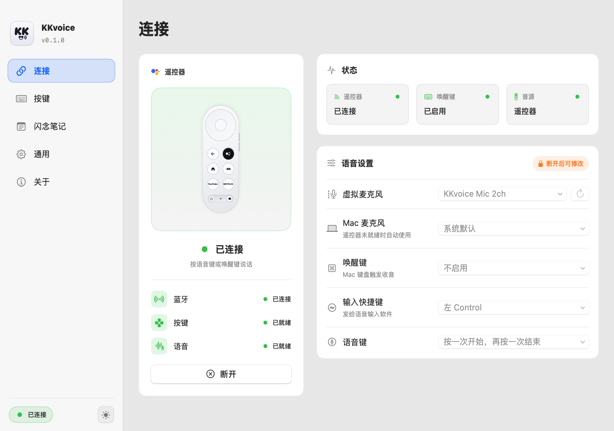

# KKvoice

把 Google TV / Chromecast 语音遥控器变成 Mac 的**无线语音麦克风**与**桌面快捷遥控器**。

配合**豆包输入法、微信输入法、Vokie** 等语音输入软件，你可以靠在椅背上或走动时直接拿着遥控器说话打字、切换窗口、控制音量，或一键新建笔记记录灵感。

## 主要功能

- **拿遥控器说话打字**：按下遥控器语音键即可开始语音输入——既支持**按一下开始、再按一下结束**（适合说长段内容），也支持**按住说话、松开结束**（适合说简短指令），无需来回切换模式。
- **离开遥控器也能顺畅收音**：当遥控器不在手边或未连接时，按下电脑键盘上的触发键（默认 `Fn`），会自动切换为你指定的电脑内置麦克风或外接麦克风继续语音输入；平时不说话时绝不后台占用麦克风。
- **外出自动省电、回家按键秒连**：带着 MacBook 外出时会自动停止后台搜索，不额外耗电；回到遥控器旁，随便按一下遥控器上的任意键即可自动重连。
- **遥控器按键自由定制**：直观的遥控器图示界面，可将方向键、确认、返回、主页、YouTube、Netflix、静音、音量、电源、信源等按键设为快捷键、打开/切换常用软件、输入常用文字或系统控制。
- **一键新建快速笔记**：支持直接唤醒系统自带的 **Apple 备忘录** 或 **闪念笔记（SnapNote）**，自动新建带 `#标签` 的笔记并把光标停在正文，方便接着语音记录。
- **一键安装与干净卸载**：自带 `KKvoice Mic` 虚拟麦克风，首次打开按提示即可一键安装；内置版本检查更新；如果以后不再使用，可在「通用」页面一键彻底卸载驱动与应用，不在电脑里留任何残留。

## 界面一览

### 按键自定义

### 快速笔记

### 通用与设置

---

## 下载与快速上手（3 步完成）

> **系统要求**：macOS 13.0（Ventura）及以上，支持 Apple Silicon 与 Intel 芯片的 Mac。

### 第一步：下载并打开应用
1. 前往 [Releases 下载页面](https://github.com/intelKANG/KKvoice/releases/latest) 下载最新的 `.zip` 安装包，解压后将 **`KKvoice.app`** 拖入「应用程序（Applications）」。
2. 首次打开如果提示“无法验证开发者”，请在访达中**右键点击 `KKvoice.app` 选择「打开」**（或在「系统设置 → 隐私与安全性」底部点击「仍要打开」）。

### 第二步：安装虚拟麦克风与开启权限
1. 首次启动 KKvoice 会自动弹窗提示安装虚拟麦克风，点击**「安装」**并输入电脑开机密码即可完成。
2. 根据界面提示，在「系统设置 → 隐私与安全性」中开启所需权限：
   - **蓝牙**：用于连接遥控器
   - **辅助功能 & 输入监控**：用于响应遥控器按键与触发语音输入法
   - **麦克风**：仅在遥控器未连接、改用电脑麦克风作为备用音源时按需使用

### 第三步：连接遥控器与设置输入法
1. **配对遥控器**：首次连接时，同时按住遥控器上的**「返回 `←` + 主页 `🏠`」3–5 秒**直到指示灯闪烁，然后在 Mac「系统设置 → 蓝牙」中点击连接 `Chromecast Remote`。
2. **设置语音输入法的麦克风**：打开你平时用的语音输入软件（**微信输入法、豆包输入法、Vokie**），在它的设置里把**麦克风设备改为 `KKvoice Mic`**。
3. **按下方推荐配置输入法快捷键**（只需按下方开启输入法的免按/启动模式，KKvoice 会自动让遥控器同时支持**短按一下切换**和**按住说话、松开结束**两种按法）：
   - **豆包输入法**：`语音输入` → 点击设置**「免按模式」**，**「全局唤起语音」**设置为**「持续模式」**。
   - **微信输入法**：`语音输入` → `快捷键` → 选**「启动语音输入」**，关闭**「按住说话」**，启用**「快捷键全局生效」**。
   - **Vokie**：`设置` → `通用` → `修改快捷键` → 打开**「免提」**模式。
   - 最后在 KKvoice「连接」页，确保「语音软件快捷键」与你在输入法里设置的按键一致（默认均为 **`Fn`**）。

---

## 常见问题与卸载说明

- **如果停用或卸载 KKvoice 后语音输入法没声音怎么办？**
  请打开你的语音输入法设置，将麦克风设备从 `KKvoice Mic` 改回**「系统默认」**即可。
- **如何干净卸载 KKvoice？**
  打开 KKvoice 进入「通用」页面，点击**「卸载 KKvoice…」**，即可一键移除虚拟麦克风驱动、清理配置并将应用移至废纸篓，不会在系统中留下多余的虚拟声卡。
- **遇到问题或有功能建议？**
  欢迎直接前往 [GitHub Issues](https://github.com/intelKANG/KKvoice/issues) 提交反馈。

---

## 技术实现与开源鸣谢

- **技术原理与踩坑记录**：如果你好奇“为什么输入法只开免按模式却能同时支持长按和短按”、“如何解决豆包输入法找不到虚拟声卡以及同键抢占冲突”等底层实现细节，欢迎阅读 **[《技术难点与实现笔记》(docs/TECHNICAL_NOTES.md)](docs/TECHNICAL_NOTES.md)**。
- **源码构建与开发架构**：面向开发者的编译测试说明详见 **[《开发指南》(DEVELOPMENT.md)](DEVELOPMENT.md)**。
- **开源鸣谢**：
  - [BlackHole](https://github.com/ExistentialAudio/BlackHole)（GNU GPL v3）：内置的 `KKvoice Mic` 虚拟麦克风驱动基于 BlackHole 源码编译。
  - [vRemoter](https://github.com/VincentKingHsu/vRemoter)：提供 Chromecast 语音遥控器协议兼容性参考。
  - 完整第三方开源许可说明详见 [THIRD_PARTY_NOTICES.md](THIRD_PARTY_NOTICES.md)。
